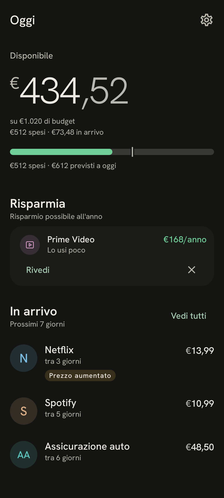
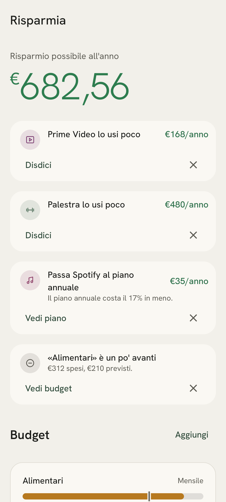

<div align="center">

# Tameki

貯め木 · "albero dei risparmi"

Spese, abbonamenti e dove risparmiare — tutto sul telefono, niente nel cloud.

[](https://github.com/antomanc/tameki/actions/workflows/ci.yml)
[](#test-su-google-play)
[](LICENSE)

[Funzioni](#funzioni) · [Privacy](#privacy) · [Test su Google Play](#test-su-google-play) · [Compilazione](#compilazione) · [Contribuire](#contribuire)

</div>

Tameki è un'app Android gratuita e open source per spese e abbonamenti. Tiene in un posto solo i
numeri che hai già, mostra quanto puoi ancora spendere questo mese e indica gli abbonamenti e le
abitudini da tagliare. Funziona interamente sul telefono: nessun account, nessun server, nessuna
chiave API. Italiano e inglese, tema chiaro e scuro, sorella dell'app meteo
[Ameki](https://github.com/antomanc/ameki).

<p align="center">
  
  
  
  
  
</p>

## Funzioni

### Spese

- Aggiunta rapida con numpad e categorie suggerite: importo, un tocco sulla categoria, salva.
- Conti, categorie, note e trasferimenti.
- Divisioni e tag vengono conservati e letti (il filtro dei Movimenti filtra per tag), ma la v1 non
  ha un editor: arrivano da import CSV, automazioni o backup. Le sottocategorie non sono ancora
  esposte nell'interfaccia.
- Importi in valuta estera con una valuta di base; i cambi di riferimento BCE vengono scaricati
  solo quando servono e un cambio inserito a mano ha sempre la precedenza.
- Elenco dei movimenti raggruppato per giorno con i totali, ricerca e filtri per periodo,
  categoria, conto, origine e tag.

### Abbonamenti

- Abbonamenti, bollette ed entrate ricorrenti in un unico elenco, ordinato per prossimo addebito,
  con una striscia dei rinnovi a 30 giorni.
- Totale mensile o annuale di tutto ciò che è attivo, normalizzato da qualsiasi ciclo di
  fatturazione.
- Promemoria prima del rinnovo e prima della fine di una prova gratuita.
- Storico dei prezzi, un avviso quando il prezzo sale e il prezzo del piano annuale quando lo hai
  inserito.
- Voto "vale la pena?" (mi piace, va bene, lo uso poco, non lo uso) e una revisione che richiede
  di nuovo il voto dopo 90 giorni, così un servizio che hai smesso di usare non resta in piedi da
  solo.
- Link per disdire per ogni abbonamento e registrazione automatica facoltativa di ogni addebito.

### Risparmia

- Occasioni ordinate per importo annuo stimato: abbonamenti non usati o usati poco, servizi che si
  sovrappongono, piani annuali, aumenti di prezzo, prove in scadenza, picchi di spesa in una
  categoria rispetto alla tua media, piccole spese frequenti proiettate sull'anno.
- Budget con barra di avanzamento che dice se sei avanti o indietro rispetto a oggi, e obiettivi di
  risparmio.
- Barre della spesa degli ultimi sei mesi e ripartizione per categoria. Le stime sono indicate come
  stime e un risparmio compare solo quando i dati lo sostengono.

### Scontrini

- Allega la foto di uno scontrino a una spesa e leggila sul dispositivo: prima il riconoscimento
  del testo di ML Kit, poi Gemini Nano dove il telefono lo supporta, infine un parser euristico.
- Importo, data, esercente e righe arrivano come bozza da correggere prima di salvare.

### AI senza chiavi

- L'app parla un formato JSON documentato. Copia un prompt pronto, incolla la risposta, guarda
  l'anteprima di ciò che verrà importato. Lo stesso vale condividendo testo o un'immagine con
  Tameki.
- L'app non invia nulla a un servizio AI. Il lavoro lo fa il tuo chatbot; Tameki interpreta il
  risultato in locale.
- Formato ed esempi: [docs/ai-format.md](docs/ai-format.md).

### Automazioni

- Deep link `tameki://add?...` e un'azione intent esplicita per Tasker, scorciatoie e assistenti.
  Per impostazione predefinita si apre la schermata già compilata; i salvataggi silenziosi restano
  spenti finché non li abiliti.
- Scorciatoie sulla home e un riquadro nelle Impostazioni rapide che aprono l'aggiunta rapida.
- Documentazione ed esempi: [docs/automation.md](docs/automation.md).

### Cattura notifiche

- Se vuoi, legge le notifiche di pagamento delle app bancarie e dei portafogli che scegli e le
  trasforma in bozze di spesa da confermare con un tocco. Tutto viene analizzato sul telefono; il
  testo delle app che non sono nel tuo elenco viene ignorato subito.

## Privacy

Nessun account, nessuna analitica, nessuna pubblicità. Il database resta nello spazio privato
dell'app.

- La rete serve solo per i cambi di riferimento BCE quando usi una valuta diversa dalla tua, e per
  il download del modello Gemini Nano gestito dal sistema. Tutto il resto funziona offline.
- Backup e ripristino cifrati con una password scelta da te, manuali o programmati su una cartella
  che scegli. Importazione CSV con mappatura delle colonne, esportazione CSV e JSON.
- La cattura delle notifiche è facoltativa, limitata alle app che metti nell'elenco e revocabile in
  qualsiasi momento.
- Blocco facoltativo con impronta digitale.

Informativa completa: [privacy policy di Tameki](https://antomanc.github.io/tameki/privacy.html),
linkata anche dentro l'app (Impostazioni → Informazioni su).

## Test su Google Play

Tameki è in test chiuso su Google Play prima dell'uscita pubblica, e Google chiede almeno 12 tester
per 14 giorni. Se hai un telefono Android puoi dare una mano:

1. Entra nel [gruppo tameki-testers](https://groups.google.com/g/tameki-testers) con il tuo account Google.
2. Apri il [link di test su Play](https://play.google.com/apps/testing/dev.antomanc.tameki), accetta e installa.
3. Tienila installata per 14 giorni e usala un po'. Segnalazioni e idee nelle [Issues](https://github.com/antomanc/tameki/issues).

Finché l'uscita su Play non è pubblica, le APK firmate sono anche nelle
[release GitHub](https://github.com/antomanc/tameki/releases). Le due vie non sono
intercambiabili: le build sono firmate in modo diverso, quindi per passare dall'una all'altra si
disinstalla e si reinstalla.

## Compilazione

Servono JDK 21 e un Android SDK con la piattaforma 37. L'app gira da Android 12 in su (minSdk 31).

```bash
export ANDROID_HOME="$HOME/Android/Sdk"   # oppure imposta sdk.dir in local.properties
scripts/verify.sh
```

`scripts/verify.sh` esegue i controlli di convenzione, i test unitari, lint e le APK debug e
release. Per un ciclo più veloce usa `./gradlew :core:model:test` o
`./gradlew :app:assembleDebug`. La firma della release legge dall'ambiente le variabili qui sotto;
senza queste variabili usa la chiave di debug (quella build non va distribuita).

| Variabile | Valore |
| --- | --- |
| `TAMEKI_KEYSTORE_PATH` | Percorso assoluto del keystore di upload |
| `TAMEKI_KEYSTORE_PASSWORD` | Password del keystore |
| `TAMEKI_KEY_ALIAS` | Alias della chiave di firma |
| `TAMEKI_KEY_PASSWORD` | Password della chiave |

Google Play usa Play App Signing: l'upload key firma ciò che carichi, Google custodisce la chiave
che firma ciò che installano gli utenti. Conserva l'upload key e usala sempre per gli aggiornamenti
futuri. Keystore e configurazioni locali restano fuori da Git.

## Architettura

| Modulo | Tipo | Dipende da |
| --- | --- | --- |
| `core:model` | JVM puro | niente: entità, denaro, parser, insight |
| `core:data` | libreria Android | `core:model`: Room, backup, CSV, cambi, impostazioni |
| `core:ui` | Android, Compose | `core:model`: tema e componenti condivisi |
| `scan:api` | JVM puro | `core:model`: contratto del lettore scontrini |
| `scan:mlkit` | libreria Android | `scan:api`, `core:model`: OCR e Gemini Nano |
| `capture` | libreria Android | `core:model`, `core:data`: lettore delle notifiche di pagamento |
| `feature:*` | Android, Compose | `core:model`, `core:data`, `core:ui`, `scan:api` |
| `widget` | Android, Glance | `core:model`, `core:data`, `core:ui` |
| `app` | applicazione | tutto: DI, navigazione, deep link, riquadro |

Le decisioni che meritano un test vivono in `core:model` come funzioni pure; il tempo arriva da un
`java.time.Clock` iniettato, ogni capacità esterna sta dietro un'interfaccia e le feature non
dipendono mai l'una dall'altra.

Ogni schermata ha screenshot Roborazzi (chiaro, scuro, font al 200%) registrati a ogni esecuzione
dei test in `<module>/build/outputs/roborazzi/`, più i test di semantica Compose per i componenti
condivisi: un badge o una chip che perde la sua etichetta TalkBack fa fallire la build.

## Contribuire

[Segnala un bug o proponi una funzione](https://github.com/antomanc/tameki/issues). Per i bug
includi versione di Android, dispositivo, passi per riprodurre e versione dell'app, e rimuovi
importi e altri dati personali da log e screenshot.

Per una modifica sostanziosa, apri prima un'issue per parlare del perimetro. Tieni le pull request
focalizzate e lancia `scripts/verify.sh` prima di dire che hai finito; se un test o uno screenshot
contraddicono la tua modifica, fermati e dillo invece di forzare il verde. Le modifiche alla UI
includono i riferimenti Roborazzi aggiornati e una verifica su dispositivo o emulatore, piegato e
aperto sui pieghevoli. Le traduzioni vivono in `res/values/strings.xml` (inglese) e
`res/values-it/strings.xml` (italiano) di ciascun modulo.

## Documentazione

- [docs/ai-format.md](docs/ai-format.md): il contratto JSON per i chatbot esterni.
- [docs/automation.md](docs/automation.md): deep link, intent, esempi per Tasker e ADB.
- [docs/play-console.md](docs/play-console.md): la checklist della scheda Play e delle dichiarazioni.
- [PRODUCT.md](PRODUCT.md) e [DESIGN.md](DESIGN.md): perimetro del prodotto e regole di design.
- [AGENTS.md](AGENTS.md): confini dei moduli e convenzioni.

## Crediti

- Tipo di carattere: [Hanken Grotesk](https://github.com/marcologous/hanken-grotesk) (OFL),
  incluso nell'app.
- L'app meteo [Ameki](https://github.com/antomanc/ameki) è la sorella di design: stesso carattere,
  stesse tinte calde della carta.

## Licenza

Tameki è software libero, distribuito con la GNU General Public License versione 3. Vedi
[LICENSE](LICENSE).

[LICENSE-EXCEPTION.md](LICENSE-EXCEPTION.md) aggiunge il permesso necessario per collegare Tameki a
Google Play services, Google ML Kit e alle librerie Android Jetpack, che da sole non sono
compatibili con la GPL.
