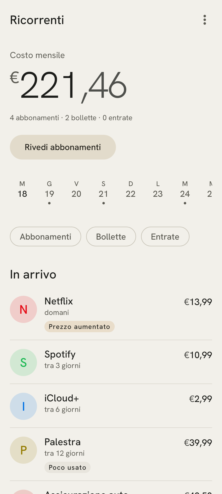

<div align="center">

# Tameki

貯め木 · "albero dei risparmi"

Un'app Android offline per spese e abbonamenti, che mostra dove puoi risparmiare. Nessun account, nessun server.

[](https://github.com/antomanc/tameki/actions/workflows/ci.yml)
[](https://github.com/antomanc/tameki/releases)
[](#installazione)
[](LICENSE)

[Installazione](#installazione) · [Funzioni](#funzioni) · [Privacy](#privacy) · [Compilazione](#compilazione) · [Contribuire](#contribuire) · [English](README.md)

</div>

Tameki tiene spese e abbonamenti in un unico posto, mostra quanto resta da spendere questo mese
e indica gli abbonamenti e le abitudini che conviene tagliare. Tutto gira sul telefono: nessun account,
nessun server, nessuna chiave API. Inglese e italiano, tema chiaro e scuro. Software libero sotto GPL-3.0.

<p align="center">
  
  
  
  
  
</p>

## Installazione

Tameki richiede Android 12 o successivo.

**Da GitHub:** scarica `tameki-0.1.0.apk` dalla [release più recente](https://github.com/antomanc/tameki/releases/latest)
e aprila. È una build di anteprima. Per ricevere gli aggiornamenti in automatico puoi aggiungere
`https://github.com/antomanc/tameki` a [Obtainium](https://github.com/ImranR98/Obtainium) (attiva
le pre-release finché l'unica release è un'anteprima).

- Play Protect può bloccare l'installazione in alcuni Paesi, perché Tameki può chiedere
  in modo facoltativo l'accesso alle notifiche. `adb install tameki-0.1.0.apk` funziona.
- L'APK è firmata con la chiave di upload dello sviluppatore. La build di Google Play è firmata
  in modo diverso, quindi per passare dall'una all'altra bisogna disinstallare prima. Esporta un
  backup da Impostazioni prima di farlo.

**Da Google Play:** Tameki è in test chiuso e non è ancora pubblica. Google richiede 12 tester per
14 giorni. Se vuoi dare una mano, entra nel [gruppo tameki-testers](https://groups.google.com/g/tameki-testers),
poi apri il [link di test](https://play.google.com/apps/testing/dev.antomanc.tameki) e installa.
Le segnalazioni vanno nelle [Issues](https://github.com/antomanc/tameki/issues).

## Funzioni

**Spese**
- Aggiunta rapida con numpad e categorie suggerite: importo, un tocco sulla categoria, salva.
- Conti, categorie, note e trasferimenti. Movimenti in più valute con una valuta di base; i cambi
  di riferimento BCE vengono scaricati solo quando servono, e un cambio inserito a mano ha sempre la
  precedenza.
- Elenco dei movimenti raggruppato per giorno con i totali, ricerca e filtri per periodo, categoria,
  conto, origine e tag.
- Divisioni e tag sono conservati e filtrabili, ma la v1 non ha un editor: arrivano da import CSV,
  automazione o backup. Le sottocategorie non sono ancora esposte nell'interfaccia.

**Abbonamenti e bollette**
- Abbonamenti, bollette ed entrate ricorrenti in un unico elenco ordinato per prossimo addebito, con
  una striscia dei rinnovi a 30 giorni e un totale mensile o annuale per qualsiasi ciclo di
  fatturazione.
- Promemoria prima di un rinnovo e prima della fine di una prova gratuita.
- Storico dei prezzi, un avviso quando il prezzo sale e il prezzo del piano annuale quando lo hai
  inserito.
- Un voto "ne vale la pena?" (ne vale la pena, va bene, poco usato, mai usato). La revisione torna
  dopo 90 giorni, così un piano che hai smesso di usare non va avanti da solo.
- Link per disdire per ogni abbonamento e registrazione automatica facoltativa di ogni addebito.

**Risparmia**
- Occasioni ordinate per importo annuo stimato: abbonamenti non usati o usati poco, servizi che si
  sovrappongono, piani annuali, aumenti di prezzo, prove in procinto di diventare a pagamento, picchi
  di una categoria rispetto alla tua media, piccole spese frequenti proiettate sull'anno.
- Budget con barra del ritmo, obiettivi di risparmio e barre della spesa degli ultimi sei mesi. Le
  stime sono indicate come stime, e un risparmio compare solo quando i dati lo sostengono.

**Scontrini**
- Allega la foto di uno scontrino a un movimento e leggila sul dispositivo: riconoscimento del testo
  di ML Kit, Gemini Nano dove il telefono lo supporta, poi un parser euristico. Importo, data,
  esercente e righe arrivano come bozza da correggere prima di salvare.

**AI senza chiavi API**
- L'app parla un formato JSON documentato ([docs/ai-format.md](docs/ai-format.md)). Copia un prompt
  pronto, incolla la risposta del chatbot, guarda l'anteprima di ciò che verrà importato. Condividere
  testo o un'immagine con Tameki funziona allo stesso modo. L'app non invia nulla a un servizio AI.

**Automazione e inserimento rapido**
- Deep link `tameki://add?...` e un'azione intent per Tasker, scorciatoie e assistenti. Per
  impostazione predefinita aprono il foglio già compilato; i salvataggi silenziosi restano spenti
  finché non li consenti ([docs/automation.md](docs/automation.md)).
- Due widget sulla home (aggiunta rapida e riepilogo del mese), un riquadro nelle Impostazioni rapide
  e scorciatoie dell'app.
- Cattura facoltativa delle notifiche di pagamento: legge le notifiche delle app di banca e dei
  portafogli che scegli e le trasforma in bozze da confermare. L'analisi avviene sul telefono; il
  testo delle altre app viene ignorato.

## Privacy

Nessun account, nessuna analitica, nessuna pubblicità. Il database resta nello spazio privato
dell'app.

- La rete serve solo per i cambi di riferimento BCE (quando usi una valuta diversa da quella di base)
  e per il download del modello Gemini Nano gestito dal sistema. Tutto il resto funziona offline.
- Backup e ripristino cifrati con una password che scegli tu, manuali o programmati su una cartella
  che scegli. Importazione CSV con mappatura delle colonne, esportazione CSV e JSON.
- Blocco facoltativo con impronta digitale.

Informativa completa: [privacy policy di Tameki](https://antomanc.github.io/tameki/privacy.html),
linkata anche dentro l'app (Impostazioni → Informazioni su).

## Compilazione

Servono JDK 21 e un Android SDK con la piattaforma 36.

```bash
export ANDROID_HOME="$HOME/Android/Sdk"   # oppure imposta sdk.dir in local.properties
scripts/verify.sh
```

`scripts/verify.sh` esegue i controlli di convenzione, i test unitari, lint e le build debug e
release; la CI esegue lo stesso script. Per un ciclo più veloce usa `./gradlew :core:model:test` o
`./gradlew :app:assembleDebug`.

La firma della release legge `TAMEKI_KEYSTORE_PATH`, `TAMEKI_KEYSTORE_PASSWORD`, `TAMEKI_KEY_ALIAS` e
`TAMEKI_KEY_PASSWORD`. Senza queste variabili la build di release ricade sulla chiave di debug e non
va distribuita. Keystore e configurazione locale sono esclusi da Git.

## Architettura

| Modulo | Tipo | Dipende da |
| --- | --- | --- |
| `core:model` | JVM puro | niente: entità, denaro, parser, insight |
| `core:data` | libreria Android | `core:model`: Room, backup, CSV, cambi, impostazioni |
| `core:ui` | Android, Compose | `core:model`: tema e componenti condivisi |
| `scan:api` | JVM puro | `core:model`: contratto del lettore scontrini |
| `scan:mlkit` | libreria Android | `scan:api`, `core:model`: OCR e Gemini Nano |
| `capture` | libreria Android | `core:model`, `core:data`: lettore delle notifiche di pagamento |
| `feature:*` | Android, Compose | `core:model`, `core:data`, `core:ui`, `scan:api` |
| `widget` | Android, Glance | `core:model`, `core:data`, `core:ui` |
| `app` | applicazione | tutto: DI, navigazione, deep link, riquadro |

Le decisioni che meritano un test vivono in `core:model` come funzioni pure. Il tempo arriva da un
`java.time.Clock` iniettato, ogni capacità esterna sta dietro un'interfaccia e le feature non
dipendono l'una dall'altra. Ogni schermata ha screenshot Roborazzi (chiaro, scuro, font al 200%)
registrati a ogni esecuzione dei test unitari, e un badge o una chip che perde la sua etichetta
TalkBack fa fallire la build.

## Contribuire

[Segnala un bug o proponi una funzione](https://github.com/antomanc/tameki/issues). Per i bug includi
versione di Android, dispositivo, versione dell'app e i passi per riprodurre, e rimuovi importi e
altri dati personali da log e screenshot.

Per una modifica sostanziosa, apri prima un'issue per discutere il perimetro. Tieni le pull request
focalizzate e lancia `scripts/verify.sh` prima di considerare il lavoro finito. Le modifiche alla UI
devono includere i riferimenti Roborazzi aggiornati e un controllo su un dispositivo o emulatore in
esecuzione. Le traduzioni vivono in `res/values/strings.xml` (inglese) e
`res/values-it/strings.xml` (italiano) di ciascun modulo.

Altro: [PRODUCT.md](PRODUCT.md) e [DESIGN.md](DESIGN.md) (perimetro e regole di design),
[AGENTS.md](AGENTS.md) (confini dei moduli e convenzioni), [docs/](docs).

## Crediti

- Tipo di carattere: [Hanken Grotesk](https://github.com/marcologous/hanken-grotesk) (OFL), incluso.
- [Ameki](https://github.com/antomanc/ameki), l'app del meteo, è la sorella di design.

## Licenza

GNU General Public License, versione 3. Vedi [LICENSE](LICENSE).
[LICENSE-EXCEPTION.md](LICENSE-EXCEPTION.md) aggiunge il permesso necessario per collegare Tameki a
Google Play services, Google ML Kit e alle librerie Jetpack.
