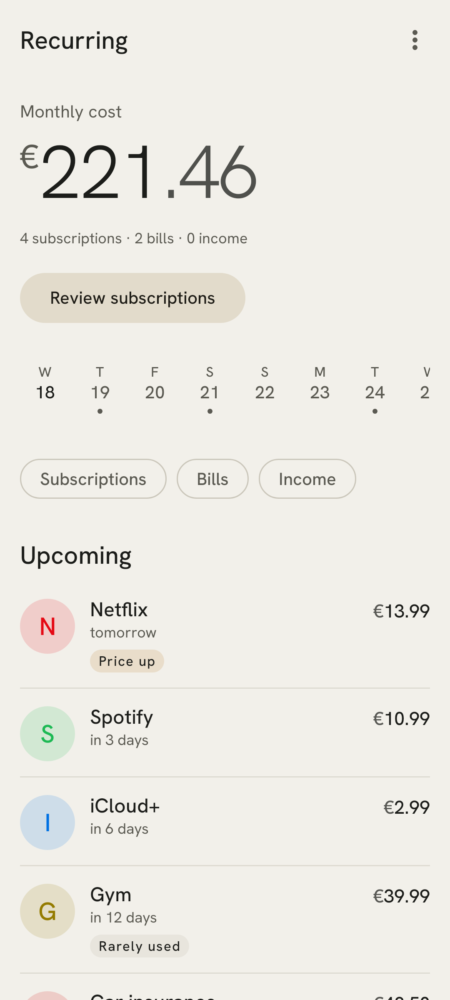

# Tameki (貯め木)

Tameki is Japanese for "tree of savings": 貯め (tame), to put aside, and 木 (ki), tree.

Tameki is a free Android app for expenses and subscriptions. It keeps the numbers you already have
in one place, shows what is left to spend this month, and points at the subscriptions and habits
worth cutting. It runs entirely on the phone: no account, no server, no API keys. Italian and
English, light and dark theme, GPL-3.0.

## Features

### Spese · expenses and activity

- Quick-add sheet with a numpad and suggested categories: amount, one category tap, save.
- Accounts, categories and subcategories, splits, notes, tags, transfers.
- Multi-currency entries with a base currency; ECB reference rates are fetched only when needed,
  and a manual rate always wins.
- Activity list grouped by day with totals, search and filters by period, category, account,
  source and tag.

### Abbonamenti · subscriptions and bills

- Subscriptions, bills and recurring income in one list, sorted by next charge, with a 30-day
  renewal strip.
- Monthly or yearly total for everything running, normalized from any billing cycle.
- Reminders before a renewal and before a free trial ends.
- Price history, a flag when a price went up, and the annual plan price when you entered it.
- "Is it worth it?" rating (love, ok, rarely, unused) and a review flow that asks again after 90
  days, so a plan you stopped using does not survive on autopilot.
- Cancel link per subscription and optional automatic logging of each charge.

### Risparmia · savings

- Ranked opportunities, each with an estimated yearly amount: unused or rarely used
  subscriptions, overlapping services, annual plans, price increases, trials about to convert,
  category spikes against your own average, small frequent purchases projected over a year.
- Budgets with a pace bar that says whether you are ahead or behind today, and savings goals.
- Six-month spending bars and category breakdowns. Estimates are labelled as estimates, and a
  saving appears only when the data supports it.

### Scontrini · receipts

- Attach a photo of a receipt to a transaction and read it on the device: ML Kit text recognition
  first, Gemini Nano where the phone supports it, then a heuristic parser.
- Amount, date, merchant and line items arrive as a draft you can correct before saving.

### AI senza chiavi · AI without keys

- The app speaks a documented JSON format. Copy a ready prompt, paste the answer back, preview
  what will be imported. The same works by sharing text or an image to Tameki.
- Nothing is sent to an AI service by the app. Your chatbot does the work; Tameki parses the
  result locally.
- Format and examples: [docs/ai-format.md](docs/ai-format.md).

### Automazioni · automation

- `tameki://add?...` deep links and an explicit intent action for Tasker, shortcuts and
  assistants. The default opens a prefilled sheet; silent saves stay off until you allow them.
- Home screen shortcuts and a Quick Settings tile for the quick-add sheet.
- Docs and examples: [docs/automation.md](docs/automation.md).

### Dati e privacy

- No account, no analytics, no ads. The database stays in the app's private storage.
- Encrypted backup and restore with a password you choose, manual or on a schedule to a folder
  you pick.
- CSV import with column mapping to migrate from another app, CSV and JSON export.
- Optional fingerprint lock.

## Screenshots

<p>
  
  
  
  
</p>

## Become a tester

Tameki is in closed testing on Google Play before its public release, and Google requires at least
12 testers for 14 days. If you have an Android phone, you can help:

1. Join the [tameki-testers group](https://groups.google.com/g/tameki-testers) with your Google account.
2. Open the [Play testing link](https://play.google.com/apps/testing/dev.antomanc.tameki), accept, and install.
3. Keep it installed for 14 days and use it a little. Feedback goes in [Issues](https://github.com/antomanc/tameki/issues).

## Build

You need JDK 21 and an Android SDK with platform 37. The app runs on Android 12 and later
(minSdk 31).

```bash
export ANDROID_HOME="$HOME/Android/Sdk"   # or set sdk.dir in local.properties
scripts/verify.sh
```

`scripts/verify.sh` runs the convention checks, unit tests, lint and both debug and release APKs.
For a quicker loop use `./gradlew :core:model:test` or `./gradlew :app:assembleDebug`. Release
signing reads `TAMEKI_KEYSTORE_PATH`, `TAMEKI_KEYSTORE_PASSWORD`, `TAMEKI_KEY_ALIAS` and
`TAMEKI_KEY_PASSWORD` from the environment and falls back to the debug key when they are absent.

## Architecture

| Module | Kind | Depends on |
| --- | --- | --- |
| `core:model` | pure JVM | nothing: entities, money, parsers, insights |
| `core:data` | Android library | `core:model`: Room, backup, CSV, exchange rates, settings |
| `core:ui` | Android, Compose | `core:model`: theme and shared components |
| `scan:api` | pure JVM | `core:model`: receipt reader contract |
| `scan:mlkit` | Android library | `scan:api`, `core:model`: OCR and Gemini Nano |
| `capture` | Android library | `core:model`, `core:data`: payment notification listener |
| `feature:*` | Android, Compose | `core:model`, `core:data`, `core:ui`, `scan:api` |
| `widget` | Android, Glance | `core:model`, `core:data`, `core:ui` |
| `app` | application | everything: DI, navigation, deep links, tile |

Decisions that need a test live in `core:model` as pure functions; time comes from an injected
`java.time.Clock`, every external capability sits behind an interface, and features never depend
on each other.

## Docs

- [docs/ai-format.md](docs/ai-format.md): the JSON contract for external chatbots.
- [docs/automation.md](docs/automation.md): deep links, intents, Tasker and ADB examples.
- [PRODUCT.md](PRODUCT.md) and [DESIGN.md](DESIGN.md): product scope and design rules.
- [AGENTS.md](AGENTS.md): module boundaries and conventions.

## License

Tameki is free software, released under the GNU General Public License, version 3. See
[LICENSE](LICENSE).

[LICENSE-EXCEPTION.md](LICENSE-EXCEPTION.md) adds the permission needed to link Tameki with Google
Play services, Google ML Kit and the Android Jetpack libraries, which are not GPL-compatible on
their own.
