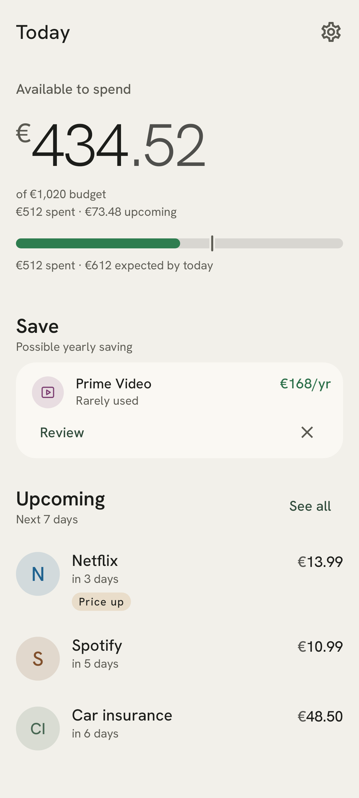
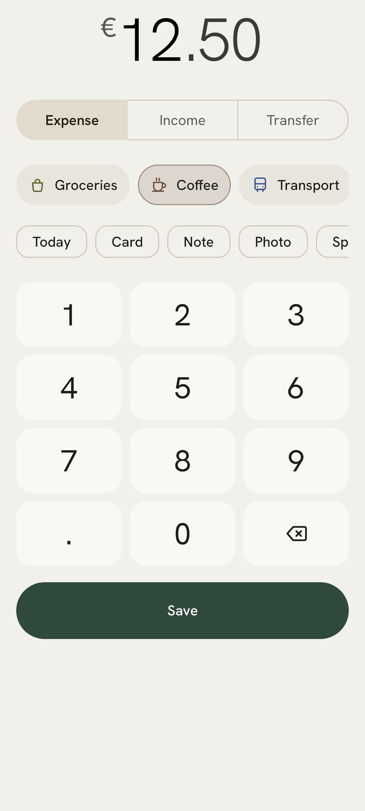

<div align="center">

# Tameki

貯め木 · "tree of savings"

An offline Android app for expenses and subscriptions that shows where you can save. No account, no server.

[](https://github.com/antomanc/tameki/actions/workflows/ci.yml)
[](https://github.com/antomanc/tameki/releases)
[](#install)
[](LICENSE)

[Install](#install) · [Features](#features) · [Privacy](#privacy) · [Build](#building) · [Contribute](#contributing) · [Italiano](README.it.md)

</div>

Tameki keeps your expenses and subscriptions in one place, shows what is left to spend this month,
and points at the subscriptions and habits worth cutting. Everything runs on the phone: no account,
no server, no API keys. English and Italian, light and dark theme. Free software under GPL-3.0.

<p align="center">
  
  
  
  
  
</p>

## Install

Tameki needs Android 12 or later.

**From GitHub:** download `tameki-0.1.0.apk` from the [latest release](https://github.com/antomanc/tameki/releases/latest)
and open it. This is a preview build. To get updates automatically you can add
`https://github.com/antomanc/tameki` to [Obtainium](https://github.com/ImranR98/Obtainium) (turn on
pre-releases while the only release is a preview).

- Play Protect may block the install in some countries, because Tameki can optionally ask for
  notification access. `adb install tameki-0.1.0.apk` works.
- The APK is signed with the developer's upload key. The Google Play build is signed differently, so
  switching between the two means uninstalling first. Export a backup from Settings before you do.

**From Google Play:** Tameki is in closed testing and not public yet. Google requires 12 testers for
14 days. If you want to help, join the [tameki-testers group](https://groups.google.com/g/tameki-testers),
then open the [testing link](https://play.google.com/apps/testing/dev.antomanc.tameki) and install.
Feedback goes in [Issues](https://github.com/antomanc/tameki/issues).

## Features

**Expenses**
- Quick-add sheet with a numpad and suggested categories: amount, one category tap, save.
- Accounts, categories, notes and transfers. Multi-currency entries with a base currency; ECB
  reference rates are fetched only when needed, and a rate you enter yourself always wins.
- Activity list grouped by day with totals, search and filters by period, category, account, source
  and tag.
- Splits and tags are stored and filterable, but v1 has no editor for them: they arrive through CSV
  import, automation or a backup. Subcategories are not exposed in the UI yet.

**Subscriptions and bills**
- Subscriptions, bills and recurring income in one list sorted by next charge, with a 30-day renewal
  strip and a monthly or yearly total for any billing cycle.
- Reminders before a renewal and before a free trial ends.
- Price history, a flag when a price went up, and the annual plan price when you entered it.
- An "is it worth it?" rating (love, ok, rarely, unused). The review comes back after 90 days, so a
  plan you stopped using does not run on autopilot.
- Cancel link per subscription and optional automatic logging of each charge.

**Savings**
- Ranked opportunities with an estimated yearly amount: unused or rarely used subscriptions,
  overlapping services, annual plans, price increases, trials about to convert, category spikes
  against your own average, small frequent purchases projected over a year.
- Budgets with a pace bar, savings goals, and six-month spending bars. Estimates are labelled as
  estimates, and a saving only appears when the data supports it.

**Receipts**
- Attach a receipt photo to a transaction and read it on the device: ML Kit text recognition, Gemini
  Nano where the phone supports it, then a heuristic parser. Amount, date, merchant and line items
  come as a draft you correct before saving.

**AI without API keys**
- The app speaks a documented JSON format ([docs/ai-format.md](docs/ai-format.md)). Copy a ready
  prompt, paste your chatbot's answer back, preview what will be imported. Sharing text or an image
  to Tameki works too. Nothing is sent to an AI service by the app.

**Automation and quick entry**
- `tameki://add?...` deep links and an intent action for Tasker, shortcuts and assistants. By default
  they open a prefilled sheet; silent saves stay off until you allow them
  ([docs/automation.md](docs/automation.md)).
- Two home screen widgets (quick add and month summary), a Quick Settings tile and app shortcuts.
- Optional payment notification capture: read notifications from the banking and wallet apps you
  choose and turn them into drafts you confirm. Parsed on the phone; text from other apps is ignored.

## Privacy

No account, no analytics, no ads. The database stays in the app's private storage.

- The network is used only for ECB reference rates (when you use a currency other than your base one)
  and for the system-managed Gemini Nano model download. Everything else works offline.
- Encrypted backup and restore with a password you choose, manual or scheduled to a folder you pick.
  CSV import with column mapping, CSV and JSON export.
- Optional fingerprint lock.

Full policy: [Tameki privacy policy](https://antomanc.github.io/tameki/privacy.html), also linked
inside the app (Settings → About).

## Building

You need JDK 21 and an Android SDK with platform 36.

```bash
export ANDROID_HOME="$HOME/Android/Sdk"   # or set sdk.dir in local.properties
scripts/verify.sh
```

`scripts/verify.sh` runs the convention checks, unit tests, lint and the debug and release builds;
CI runs the same script. For a quicker loop use `./gradlew :core:model:test` or
`./gradlew :app:assembleDebug`.

Release signing reads `TAMEKI_KEYSTORE_PATH`, `TAMEKI_KEYSTORE_PASSWORD`, `TAMEKI_KEY_ALIAS` and
`TAMEKI_KEY_PASSWORD`. Without them the release build falls back to the debug key and must not be
distributed. Keystores and local configuration are excluded from Git.

## Architecture

| Module | Kind | Depends on |
| --- | --- | --- |
| `core:model` | pure JVM | nothing: entities, money, parsers, insights |
| `core:data` | Android library | `core:model`: Room, backup, CSV, exchange rates, settings |
| `core:ui` | Android, Compose | `core:model`: theme and shared components |
| `scan:api` | pure JVM | `core:model`: receipt reader contract |
| `scan:mlkit` | Android library | `scan:api`, `core:model`: OCR and Gemini Nano |
| `capture` | Android library | `core:model`, `core:data`: payment notification listener |
| `feature:*` | Android, Compose | `core:model`, `core:data`, `core:ui`, `scan:api` |
| `widget` | Android, Glance | `core:model`, `core:data`, `core:ui` |
| `app` | application | everything: DI, navigation, deep links, tile |

Decisions that need a test live in `core:model` as pure functions. Time comes from an injected
`java.time.Clock`, every external capability sits behind an interface, and features never depend on
each other. Every screen has Roborazzi screenshots (light, dark, 200% font) recorded on each unit-test
run, and a badge or chip that loses its TalkBack label fails the build.

## Contributing

[Report a bug or suggest a feature](https://github.com/antomanc/tameki/issues). For bugs, include your
Android version, device, app version and the steps to reproduce, and remove amounts and other
personal data from logs and screenshots.

For a substantial change, open an issue first to discuss scope. Keep pull requests focused and run
`scripts/verify.sh` before calling work done. UI changes should include updated Roborazzi references
and a check on a running device or emulator. Translations live in each module's
`res/values/strings.xml` (English) and `res/values-it/strings.xml` (Italian).

More: [PRODUCT.md](PRODUCT.md) and [DESIGN.md](DESIGN.md) (scope and design rules),
[AGENTS.md](AGENTS.md) (module boundaries and conventions), [docs/](docs).

## Credits

- Typeface: [Hanken Grotesk](https://github.com/marcologous/hanken-grotesk) (OFL), bundled.
- [Ameki](https://github.com/antomanc/ameki), the weather app, is the design sibling.

## Licence

GNU General Public License, version 3. See [LICENSE](LICENSE).
[LICENSE-EXCEPTION.md](LICENSE-EXCEPTION.md) adds the permission needed to link Tameki with Google
Play services, Google ML Kit and the Jetpack libraries.
