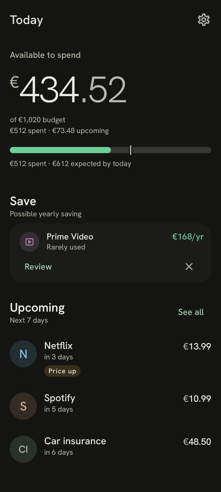
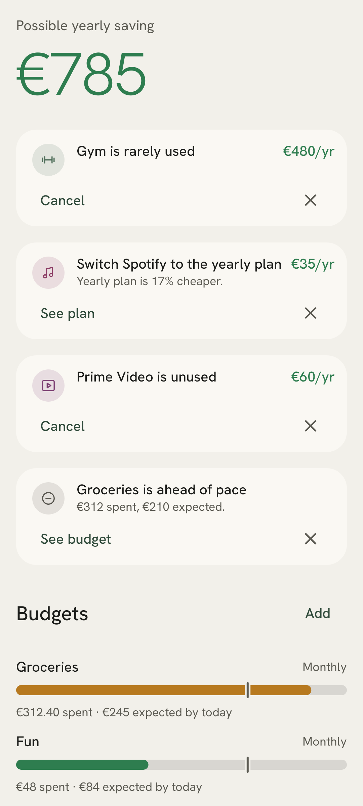

<div align="center">

# Tameki

貯め木 · "tree of savings"

Expenses, subscriptions and where to save — all on your phone, none in the cloud.

[](https://github.com/antomanc/tameki/actions/workflows/ci.yml)
[](#testing-on-google-play)
[](LICENSE)

[Features](#features) · [Privacy](#privacy) · [Testing on Google Play](#testing-on-google-play) · [Build](#building) · [Contribute](#contributing)

</div>

Tameki is a free, open source Android app for expenses and subscriptions. It keeps the numbers you
already have in one place, shows what is left to spend this month, and points at the subscriptions
and habits worth cutting. It runs entirely on the phone: no account, no server, no API keys.
Italian and English, light and dark theme, sibling of the weather app [Ameki](https://github.com/antomanc/ameki).

<p align="center">
  
  
  
  
  
</p>

## Features

### Spese · expenses and activity

- Quick-add sheet with a numpad and suggested categories: amount, one category tap, save.
- Accounts, categories, notes and transfers.
- Splits and tags are kept and read (the Activity filter can narrow by tag), but v1 has no editor
  for them: they arrive through CSV import, automation or a backup. Subcategories are not exposed
  in the UI yet.
- Multi-currency entries with a base currency; ECB reference rates are fetched only when needed,
  and a manual rate always wins.
- Activity list grouped by day with totals, search and filters by period, category, account,
  source and tag.

### Abbonamenti · subscriptions and bills

- Subscriptions, bills and recurring income in one list, sorted by next charge, with a 30-day
  renewal strip.
- Monthly or yearly total for everything running, normalized from any billing cycle.
- Reminders before a renewal and before a free trial ends.
- Price history, a flag when a price went up, and the annual plan price when you entered it.
- "Is it worth it?" rating (love, ok, rarely, unused) and a review flow that asks again after 90
  days, so a plan you stopped using does not survive on autopilot.
- Cancel link per subscription and optional automatic logging of each charge.

### Risparmia · savings

- Ranked opportunities, each with an estimated yearly amount: unused or rarely used
  subscriptions, overlapping services, annual plans, price increases, trials about to convert,
  category spikes against your own average, small frequent purchases projected over a year.
- Budgets with a pace bar that says whether you are ahead or behind today, and savings goals.
- Six-month spending bars and category breakdowns. Estimates are labelled as estimates, and a
  saving appears only when the data supports it.

### Scontrini · receipts

- Attach a photo of a receipt to a transaction and read it on the device: ML Kit text recognition
  first, Gemini Nano where the phone supports it, then a heuristic parser.
- Amount, date, merchant and line items arrive as a draft you can correct before saving.

### AI senza chiavi · AI without keys

- The app speaks a documented JSON format. Copy a ready prompt, paste the answer back, preview
  what will be imported. The same works by sharing text or an image to Tameki.
- Nothing is sent to an AI service. Your chatbot does the work; Tameki parses the result locally.
- Format and examples: [docs/ai-format.md](docs/ai-format.md).

### Automazioni · automation

- `tameki://add?...` deep links and an explicit intent action for Tasker, shortcuts and
  assistants. The default opens a prefilled sheet; silent saves stay off until you allow them.
- Home screen shortcuts and a Quick Settings tile for the quick-add sheet.
- Docs and examples: [docs/automation.md](docs/automation.md).

### Cattura notifiche · notification capture

- Optionally read payment notifications from the banking and wallet apps you pick, and turn them
  into expense drafts you confirm with one tap. Everything is parsed on the phone; text from apps
  that are not on your list is ignored immediately.

## Privacy

No account, no analytics, no ads. The database stays in the app's private storage.

- The network is used only to fetch ECB reference rates when you use a currency other than your
  base one, and for the system-managed Gemini Nano model download. Everything else works offline.
- Encrypted backup and restore with a password you choose, manual or on a schedule to a folder you
  pick. CSV import with column mapping, CSV and JSON export.
- Notification capture is optional, limited to the apps you allowlist, and revocable at any time.
- Optional fingerprint lock.

Full policy: [Tameki privacy policy](https://antomanc.github.io/tameki/privacy.html), also linked
inside the app (Settings → About).

## Testing on Google Play

Tameki is in closed testing on Google Play before its public release, and Google requires at least
12 testers for 14 days. If you have an Android phone, you can help:

1. Join the [tameki-testers group](https://groups.google.com/g/tameki-testers) with your Google account.
2. Open the [Play testing link](https://play.google.com/apps/testing/dev.antomanc.tameki), accept, and install.
3. Keep it installed for 14 days and use it a little. Feedback goes in [Issues](https://github.com/antomanc/tameki/issues).

Until the Play release is public, signed APKs are also on
[GitHub Releases](https://github.com/antomanc/tameki/releases). Installing from Play and from
GitHub are not interchangeable: the two builds are signed differently, so switch by uninstalling
and reinstalling.

## Building

You need JDK 21 and an Android SDK with platform 37. The app runs on Android 12 and later
(minSdk 31).

```bash
export ANDROID_HOME="$HOME/Android/Sdk"   # or set sdk.dir in local.properties
scripts/verify.sh
```

`scripts/verify.sh` runs the convention checks, unit tests, lint and both debug and release APKs.
For a quicker loop use `./gradlew :core:model:test` or `./gradlew :app:assembleDebug`. Release
signing reads the environment variables below and falls back to the debug key when they are
absent (that fallback build must not be distributed).

| Variable | Value |
| --- | --- |
| `TAMEKI_KEYSTORE_PATH` | Absolute path to the upload keystore |
| `TAMEKI_KEYSTORE_PASSWORD` | Keystore password |
| `TAMEKI_KEY_ALIAS` | Signing key alias |
| `TAMEKI_KEY_PASSWORD` | Key password |

Google Play uses Play App Signing: the upload key signs what you upload, Google holds the key that
signs what users install. Keep the upload key safe and use the same key for future updates.
Keystores and local configuration are excluded from Git.

## Architecture

| Module | Kind | Depends on |
| --- | --- | --- |
| `core:model` | pure JVM | nothing: entities, money, parsers, insights |
| `core:data` | Android library | `core:model`: Room, backup, CSV, exchange rates, settings |
| `core:ui` | Android, Compose | `core:model`: theme and shared components |
| `scan:api` | pure JVM | `core:model`: receipt reader contract |
| `scan:mlkit` | Android library | `scan:api`, `core:model`: OCR and Gemini Nano |
| `capture` | Android library | `core:model`, `core:data`: payment notification listener |
| `feature:*` | Android, Compose | `core:model`, `core:data`, `core:ui`, `scan:api` |
| `widget` | Android, Glance | `core:model`, `core:data`, `core:ui` |
| `app` | application | everything: DI, navigation, deep links, tile |

Decisions that need a test live in `core:model` as pure functions; time comes from an injected
`java.time.Clock`, every external capability sits behind an interface, and features never depend on
each other.

Every screen has Roborazzi screenshots (light, dark, 200% font) recorded on each unit-test run,
under `<module>/build/outputs/roborazzi/`, plus Compose semantics tests for shared components:
a badge or chip that loses its TalkBack label fails the build.

## Contributing

[Report a bug or suggest a feature](https://github.com/antomanc/tameki/issues). For bugs, include
your Android version, device, the steps to reproduce and the app version, and remove amounts and
other personal data from logs and screenshots.

For a substantial change, open an issue first to discuss scope. Keep pull requests focused and
run `scripts/verify.sh` before calling work done; if a test or a screenshot expectation
contradicts your change, stop and say so instead of forcing green. UI changes should include
updated Roborazzi references and a check on a running device or emulator, folded and unfolded on
foldables. Translations live in each module's `res/values/strings.xml` (English) and
`res/values-it/strings.xml` (Italian).

## Docs

- [docs/ai-format.md](docs/ai-format.md): the JSON contract for external chatbots.
- [docs/automation.md](docs/automation.md): deep links, intents, Tasker and ADB examples.
- [docs/play-console.md](docs/play-console.md): the store listing and declarations checklist.
- [PRODUCT.md](PRODUCT.md) and [DESIGN.md](DESIGN.md): product scope and design rules.
- [AGENTS.md](AGENTS.md): module boundaries and conventions.

## Credits

- Typeface: [Hanken Grotesk](https://github.com/marcologous/hanken-grotesk) (OFL), bundled.
- The weather app [Ameki](https://github.com/antomanc/ameki) is the design sibling: same typeface,
  same warm paper neutrals.

## Licence

Tameki is free software, released under the GNU General Public License, version 3. See
[LICENSE](LICENSE).

[LICENSE-EXCEPTION.md](LICENSE-EXCEPTION.md) adds the permission needed to link Tameki with Google
Play services, Google ML Kit and the Android Jetpack libraries, which are not GPL-compatible on
their own.
